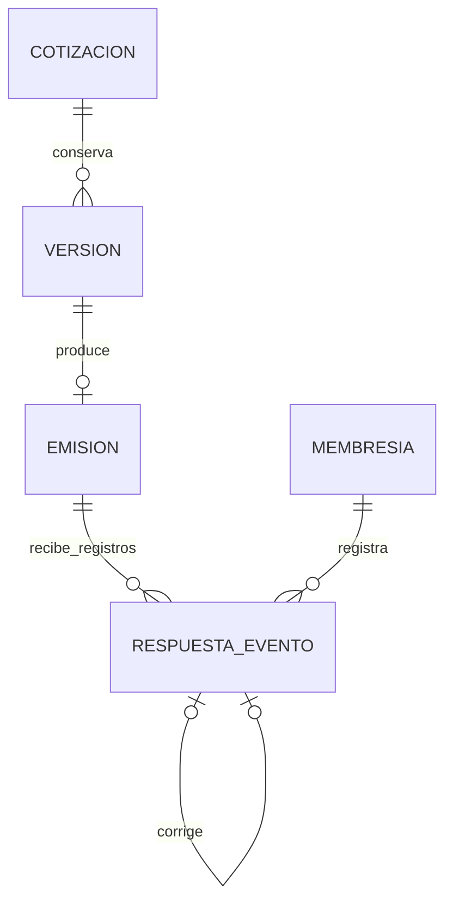

# ADR-0013 — Seguimiento interno por emisión y vigencia del documento

- Fecha: 05/10/2026.
- Estado: aceptado para el DEMO local; plan aprobado por el propietario en esta sesión.
- Complementa ADR-0008, ADR-0009, ADR-0010 y ADR-0012.

## 1. Fuentes y alcance

La trazabilidad exacta al Word maestro v1.3, las tablas originales y VBA está en [el módulo 9](../cotizaciones/seguimiento-respuestas.md). El libro usa estados de versión que mezclan preparación y resultado comercial. La web mantiene tres dimensiones: preparación/revisión, documento emitido y su vigencia, y respuesta registrada internamente. APROBADA significa aprobación del equipo; no significa aceptación del cliente.

Solo se registra la respuesta recibida por el equipo. No se implementan portal, correo, enlaces públicos, firma, anulación de documentos emitidos ni efectos sobre pedidos, compras, impuestos u obra.

## 2. Decisiones autorizadas frente a la fase 1

1. La **fecha recibida manda**: la fecha de respuesta debe estar entre emisión y vencimiento, ambos inclusive, y no ser futura según el servidor. Se permite capturarla después de vencer el documento si fue recibida dentro de ese intervalo. Una respuesta recibida fuera de vigencia se bloquea. El VBA no comprueba expresamente ese último límite y su marcado automático a Vencida impide el registro tardío; esta es una adaptación DEMO elegida por el propietario, no una regla nueva atribuida al Excel.
2. El **Preparador corrige** mediante un evento nuevo, citando el registro vigente y un motivo obligatorio. La fuente no define la corrección comercial; el propietario eligió conservar el historial en lugar de editarlo. Motivo: 10–500 caracteres, con alguna letra; nota opcional: hasta 2.000 caracteres. Son límites técnicos del DEMO.

## 3. Relación entre entidades

Cada versión es una instantánea inmutable; cada versión puede emitirse una vez. Cada respuesta cita una **emisión exacta**, que fija su versión y cotización. No hay respuesta a un folio genérico ni herencia a vN+1. La emisión posterior sustituye la anterior para una primera respuesta; una corrección del registro ya existente permanece permitida como historia de ese documento sustituido. Nada cambia sus importes, versión, aprobación o PDF original.

`respuesta_cliente_evento` es una cadena: evento inicial número 1; cada corrección cita la cabeza y suma 1. El registro vigente es la cabeza, nunca una fila sobrescrita. FK compuestas aseguran organización/emisión/autor y que el anterior pertenezca a la misma emisión. Índices únicos impiden dos raíces, números repetidos y bifurcaciones. Disparadores impiden UPDATE/DELETE incluso al propietario de la tabla y validan funciones, cadena, sustitución y fechas al insertar. Se conserva el nombre del registrador en el evento; no se atribuye una sesión al cliente.

## 4. Fecha y presentación

Se reutiliza `Reloj` para la fecha civil del servidor en `SOFTARQ_ZONA_HORARIA` (America/Mexico_City por omisión) y `RelojInstante` para la marca temporal. `fecha_respuesta` la captura el equipo; `fecha_registro`, `registrado_en`, identidad y nombre los asigna el servidor. Los relojes fijos de pruebas no son entradas HTTP del producto.

Documento vigente si `fechaServidor <= vigenteHasta`; vencido después. La vigencia se evalúa al consultar/actuar, sin scheduler ni escrituras por el paso del tiempo. Aceptada o Rechazada sigue visible tras vencer y en el documento sustituido. El original sigue «Emitido»; la vigencia y el resultado tienen etiquetas aparte. La UI explica el intervalo y los bloqueos; no altera ni marca el PDF con «COPIA» o «SUSTITUIDA» (ADR-0010 conserva sus bytes).

## 5. Autorización y concurrencia

`cotizaciones.consultar` lee; solo Preparador recibe `respuestas.registrar` y `respuestas.corregir`. Identidad, organización y capacidades proceden de la sesión. Validación estricta, CSRF, Origin, límites y errores comunes siguen vigentes. Consultas filtran organización y emisión; una referencia ajena responde 404.

La función SQL usa el bloqueo de `cotizacion_borrador` que serializa emisiones y modificaciones del mismo folio. Vuelve a comprobar la cabeza/sustitución dentro del bloqueo; una carrera devuelve 409 con `seguimientoVigente`. Registro, bitácora e idempotencia se confirman en una sola sentencia. Se mantiene la clave de 24 horas por organización/usuario/intención. Un replay devuelve el evento original aunque ya haya correcciones.

La web conserva fecha, nota, resultado y motivo ante errores. No cambia automáticamente la cabeza que se estaba corrigiendo. Tras comparar, el usuario elige explícitamente corregir el registro vigente con su captura. Historial descendente en páginas de 50, sin truncar lo persistido.

## 6. Permisos y recuperación

`softarq_app`: SELECT/INSERT en la tabla; sin UPDATE, DELETE ni DDL. Funciones SECURITY INVOKER, search_path fijo, EXECUTE revocado a PUBLIC. El procedimiento de permisos reaplicado tras restaurar concede lo mismo y tolera respaldos con esquemas anteriores.

`softarq_respaldo` obtiene SELECT por los privilegios por defecto de `softarq_migrator`; se comprueba realmente con el rol limitado. Respaldo incluye la tabla automáticamente dentro de la instantánea exportada. La prueba de restauración comprueba cadenas, fechas, autor/organización, permisos, disparadores y eventos/notas íntegros. La prueba operativa nueva emite y corrige después de exportar una instantánea abierta; verifica que el destino aislado conserva solo lo anterior. Los resultados ejecutados se registran en HANDOFF, sin dar por repetido el aprovisionamiento administrativo.
